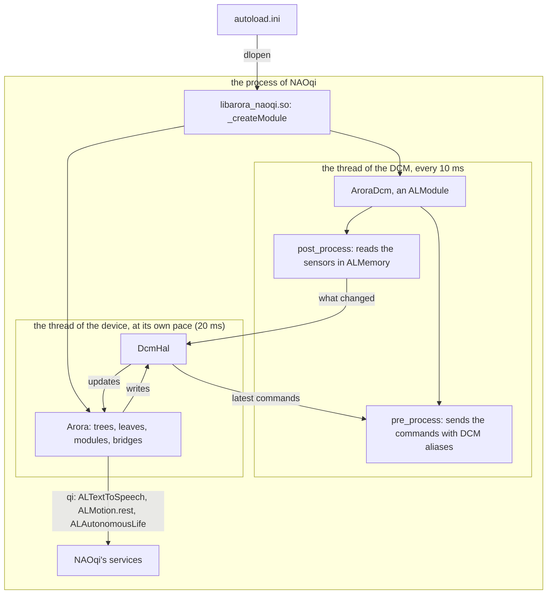

# arora-aldebaran

Arora support for Aldebaran robots: NAO and Pepper run as Arora devices.

`arora-aldebaran` is the device runner: it connects to the robot through a HAL, runs a
behavior tree on it, and serves it to Arora's bridges, Semio Studio included. The HAL is
chosen when the runner is built ([Choosing a HAL](#choosing-a-hal)); the default one,
[`naoqi`](#the-naoqi-hal), talks to the robot's NAOqi with
[`libqi-vibe`](https://crates.io/crates/libqi-vibe), a Rust implementation of the `qi`
framework: no C++ SDK. The runner works two ways, and the device a third:

- **From your computer**, the quickest way to try it: it builds like any Rust program and
  drives the robot over the network, through NAOqi's port 9559.
  [Try it on a NAO](#try-it-on-a-nao).
- **On the robot itself**, where the device runs on its own, with no computer attached.
  [Deploy it on the robot](#deploy-it-on-the-robot).
- **Inside NAOqi**, as a library NAOqi loads at its start: the device drives the joints from
  the loop of the DCM, every 10 ms, with no network in between.
  [Inside NAOqi](#inside-naoqi-on-the-loop-of-the-dcm).

The second way is the remarkable one. Arora is written in Rust, so the whole device (the
runtime, its behavior trees, its WebAssembly modules, its Semio Studio connection)
cross-compiles to a single static binary for the NAO's own computer, a 32-bit Intel Atom,
with nothing to install on the robot. That is rare in the robotics ecosystem: today's
stacks, ROS 2 and the Python AI tooling among them, seldom run on the NAO's on-board
computer, and stay on a separate machine that drives the robot over the network.

- [Try it on a NAO](#try-it-on-a-nao)
- [Deploy it on the robot](#deploy-it-on-the-robot)
- [Semio Studio](#semio-studio)
- [Behaviors](#behaviors)
- [Choosing a HAL](#choosing-a-hal)
- [The NAOqi HAL](#the-naoqi-hal)
- [Inside NAOqi, on the loop of the DCM](#inside-naoqi-on-the-loop-of-the-dcm)
- [The repository](#the-repository)

## Try it on a NAO

What you get: the robot says "Arora is ready" while its wrists rotate slightly and its hands
open and close; the terminal UI plays it again when you press `r`; built with Studio, the
device appears in your Semio Studio account. The runner runs on your computer and drives
the robot over the network: nothing to cross-compile, nothing to install on the robot.

### 1. Prepare the robot

1. Connect the NAO to your network. Its host is `<robot_name>.local`, where `<robot_name>` is
   the name it says when you press its chest button once. From your computer,
   `nc -z <robot_name>.local 9559` checks that its NAOqi answers.
2. Sit the robot down, or let it crouch in its rest posture: the default behavior stiffens
   only the wrists and hands, nothing that holds the robot up.

There is no need to turn Autonomous Life off: the HAL does it when it connects, so that the
robot's own life does not move the joints Arora drives. Turning it off can send the robot
to its rest posture, one more reason to sit it down first. To keep Autonomous Life on, set
`"disable_autonomous_life": false` in the [configuration](#configuration).

### 2. Run it from your computer

You need Rust, installed with [rustup](https://rustup.rs): the repository pins its nightly
toolchain (`rust-toolchain.toml`), which rustup fetches on the first build. Then, from the
repository root, on macOS or Linux:

```sh
cargo run --release -p arora-aldebaran -- tcp://<robot_name>.local:9559
```

The first build takes a while (about ten minutes); the next runs start at once. The device
serves the open local bridge; to connect it to Semio Studio, see
[Semio Studio](#semio-studio), which also needs Internet access.

A robot that requires NAOqi authentication takes its credentials from a JSON file given
after the address: `{"user": "nao", "password": "<password>"}`.

### 3. Use it

The device starts, the robot says "Arora is ready" with its hands, and:

| Key | Does |
|---|---|
| `r` | plays the default behavior again |
| `PgUp` / `PgDn` / `End`, mouse wheel | scroll the logs, follow them again |
| `q`, `Ctrl-C` | stop the device; the robot goes to rest (it sits or crouches, then relaxes) |

More logs: set `RUST_LOG=debug` before the command. Without a terminal (`nohup`, a
service), the runner is headless and asks nothing.

A run that connects to Studio ([Semio Studio](#semio-studio)) and is not enrolled yet shows
an enrollment code on the terminal UI, to enter in Studio.

Options (`--help` lists them):

- `--tree <file.groot.xml>` runs another behavior tree ([Behaviors](#behaviors)), `--no-tree`
  none;
- `--module <dir>` (repeatable) loads a module besides the device directory's;
- `--device <name>`, `--device-dir <path>` and `--bridge-port <port>` give the device this
  run is: several devices on one machine each take their own name and port;
- in a build with Studio, `--no-studio` serves the open local bridge instead;
- instead of the address, a JSON [configuration](#configuration) file, and after it a
  second JSON file that overrides it.

Modules: the device loads every module directory in its device directory's `modules/`,
then each `--module <dir>`, as the `arora` runner does: a module's `header.json` beside its
artifact, and optionally its records in `records/`, which describe every function it
exports. The layout is in
[arora's readme](https://github.com/semio-ai/arora-sdk/blob/main/crates/arora/readme.md#where-a-device-keeps-its-data).
A tree's leaves call the functions of these modules as they call `Say` and `HandsReady`. A
module directory that does not read fails the start, naming the module, before the robot is
reached; a module the engine rejects, or whose record does not describe it, fails once the
robot is connected.

## Deploy it on the robot

Once it works from your computer, deploy it: the same device, cross-compiled, runs on the
NAO itself, without your computer. The robot needs SSH access (`ssh nao@<robot_name>.local`,
the password is the robot's, `nao` unless it was changed) and, for Semio Studio, Internet
access and the right date (TLS checks certificates against it: `date` on the robot should
print the current time).

### 1. Cross-compile the runner for the NAO

On a NAO V4 or V5, whose computer is a 32-bit Atom, the target is `i686-unknown-linux-musl`:
`musl` makes a static binary that needs nothing from the robot's system, which is old.

On a Mac, from the repository root:

```sh
# Once: the cross C toolchain (for the crates with C code: ring, aws-lc-sys, zstd-sys),
# CMake (aws-lc-sys builds with it), and the Rust target for the pinned toolchain.
brew install messense/macos-cross-toolchains/i686-unknown-linux-musl cmake
rustup target add i686-unknown-linux-musl

# The build. The linker comes from .cargo/config.toml; the C compiler from these variables.
CC_i686_unknown_linux_musl=i686-unknown-linux-musl-gcc \
CXX_i686_unknown_linux_musl=i686-unknown-linux-musl-g++ \
AR_i686_unknown_linux_musl=i686-unknown-linux-musl-ar \
cargo build --release -p arora-aldebaran --target i686-unknown-linux-musl

# Strip the debug information the release profile keeps: over 300 MB down to about 50 MB.
i686-unknown-linux-musl-strip target/i686-unknown-linux-musl/release/arora-aldebaran
```

On an Intel Mac, point `CARGO_TARGET_I686_UNKNOWN_LINUX_MUSL_LINKER` at
`/usr/local/bin/i686-unknown-linux-musl-gcc` (`.cargo/config.toml` names the Apple Silicon
path).

On Linux, [`cargo-zigbuild`](https://github.com/rust-cross/cargo-zigbuild) brings the cross
C compiler (zig) and the linker:

```sh
pip install ziglang && cargo install cargo-zigbuild    # once
rustup target add i686-unknown-linux-musl              # once
CARGO_PROFILE_RELEASE_DEBUG=0 cargo zigbuild --release -p arora-aldebaran --target i686-unknown-linux-musl
```

The binary is `target/i686-unknown-linux-musl/release/arora-aldebaran`: a statically linked
32-bit ELF. The first build takes a while (half an hour on an M1, mostly `aws-lc-sys` and
`wasmtime`). Add `--features studio` for a device that connects to Semio Studio.

### 2. Copy it to the robot

```sh
scp target/i686-unknown-linux-musl/release/arora-aldebaran nao@<robot_name>.local:~/
```

### 3. Run it on the robot

```sh
ssh -t nao@<robot_name>.local   # -t: the terminal UI needs a terminal
./arora-aldebaran tcp://localhost:9559
```

The device then behaves as [from your computer](#3-use-it). Built with Studio, it enrolls
on its first run: enter the code it shows in Studio. To leave it running after you log out,
run it headless with `nohup`: an enrolled device connects with its saved credential, and one
that is not enrolls with `STUDIO_ENROLLMENT_TOKEN` (see [Semio Studio](#semio-studio)).

On the robot, the device directory follows the same rule as anywhere: `--device-dir`
(`ARORA_DEVICE_DIR`) when given, else `semio/arora/devices/<name>/` in the user data
directory (`~/.local/share` on the robot), the name being `--device` (`ARORA_DEVICE`), else
`default`;
[arora's readme](https://github.com/semio-ai/arora-sdk/blob/main/crates/arora/readme.md#where-a-device-keeps-its-data)
has the whole rule. Its modules go in `modules/` there. The binary is static, so it loads
WebAssembly modules: a native module (a dynamic library) fails the start, naming it.

## Semio Studio

Building with Semio Studio is the opt-in: the runner built with the `studio` feature connects
to Studio on every run unless the run passes `--no-studio`; built without it, it serves the
open local bridge and has no Studio option.

```sh
cargo run --release -p arora-aldebaran --features studio -- tcp://<robot_name>.local:9559
```

A device enrolls with Studio once, on its first run that connects:

- **by code**: the run shows a code, on the terminal UI's prompt line and in the log, which
  you enter in Studio, choosing the device's owner;
- **with an enrollment token**, for a robot run with neither screen nor operator: create one
  in Studio and set it in `STUDIO_ENROLLMENT_TOKEN` for that run. It is read from the
  environment only and never logged.

Studio then shows the device, with its name (`DEVICE_NAME`, else what you type on the
terminal UI) and its model (`MODEL_FAMILY`, else what the HAL describes: `nao` for a NAO).
Later runs connect with the credential the enrollment saved, kept under the device's name in
Semio's device store (`<data_local_dir>/semio/devices/<name>/`, or `SEMIO_DEVICE_STORE`): a
device run from your computer and then deployed on the robot enrolls once on each machine.
Run several devices on one machine with `--device <name>` (`ARORA_DEVICE`), each with its
own `--bridge-port`.
[arora's readme](https://github.com/semio-ai/arora-sdk/blob/main/crates/arora/readme.md#semio-studio-is-opt-in)
has the details: where the credential is, what a refused code does, and how to enroll a
device before it runs.

## Behaviors

What the robot does over time is a behavior tree's (Groot XML). The trees name the keys of
the Arora robot standard ([Keys](#keys)), which every HAL maps, so a tree runs on any of
them.

### The default behavior

[`trees/ready.groot.xml`](crates/arora-aldebaran/trees/ready.groot.xml), built into the
runner:

```text
Fallback
├── Sequence
│   ├── IsStringSet command.ready     (a request is pending)
│   ├── Parallel
│   │   ├── HandsReady      wrists ±20° twice, hands open and close three times, over 4 s
│   │   └── Fallback
│   │       ├── Say "Arora is ready"
│   │       └── Succeed     (a robot that cannot speak still moves)
│   ├── EndSpeech                     (the episode ends: the next request
│   ├── EndGestures                    speaks and moves anew)
│   └── UnsetString command.ready     (the request is handed back)
└── Succeed                 (rest)
```

The runner starts with a request in `command.ready` (any non-empty text). The `r` key
writes a new one; so does any bridge client, Studio included: the runner opens
`command.ready` to remote writers, and no other key. The gesture stiffens the four joints it
moves (0.6) and relaxes them once over.

### A tree to try a robot with

[`trees/touch.groot.xml`](crates/arora-aldebaran/trees/touch.groot.xml) (`--tree`) adds a
greeting to the default behavior: a touch of the front of the head (`touch.head.front`)
makes the robot say "Hello, you touched my head" as its hands play the gesture. The greeting
plays to its end once started, the touch released or not (a `SequenceStar`), and one touch
greets once: holding the head does not repeat it, the next touch after a release greets
again (`touch_tree.armed`, which the greeting takes and a release gives back).

### Leaves

Besides the native nodes of Arora's trees (`Sequence`, `SequenceStar`, `Fallback`,
`Parallel`, `Succeed`, `Equal`, `IsStringSet`, `SetString`, `UnsetString`…), the runner gives
trees two host modules:

- **`Say`**, the HAL's voice: the speech contract of Arora's trees (`say(text, voice,
  viseme)`, under the ids its other providers, `say-silent` and Piper's, share). `Running`
  while the robot speaks, then `Success` while ticked; a new text, or the leaf halted for
  250 ms, stops the sentence. `EndSpeech` ends the episode: it stops the sentence under way
  and forgets the said ones, so the same text is said again when asked again. With `naoqi`,
  the voice is `ALTextToSpeech`.
- **`HandsReady`** ([`gestures`](crates/arora-aldebaran/src/gestures.rs)): the default
  behavior's gesture, timed joint targets and stiffness on the wrists and hands, paced by
  the tree's `arora/dt`. `EndGestures` ends the episode, so the next `HandsReady` plays from
  its start. It writes standard keys only, so it plays on any HAL.

A literal compared with `Equal` is typed in JSON form: `b='json:{"bool":true}'`.

## Choosing a HAL

The runner drives the robot through the HAL its build selects, with a cargo feature of
`arora-aldebaran`:

| Feature | HAL | Reaches the robot through | Status |
|---|---|---|---|
| `naoqi` (default) | [`arora-hal-naoqi`](crates/arora-hal-naoqi) | NAOqi's services, over the network: `ALMemory`, `ALMotion`, `ALLeds`, `ALTextToSpeech` | runs; from a computer or on the robot |
| none: a library, not the runner | [`arora-hal-naoqi-dcm`](crates/arora-hal-naoqi-dcm) | the DCM's loop, every 10 ms, from the library NAOqi loads ([`arora-naoqi-module`](crates/arora-naoqi-module)) | runs in a fake NAOqi; [not yet on a robot](#its-status) |

Every HAL maps the same [keys](#keys) and gives the same leaves, so trees, modules and the
command line do not change with it: only what names the robot (the first argument) may.
The DCM HAL runs in NAOqi's process, so it is not the runner's: the library NAOqi loads runs
the device on it ([Inside NAOqi](#inside-naoqi-on-the-loop-of-the-dcm)).
A build without a HAL is refused at compile time. In code, `arora_aldebaran::robot::connect`
is the HAL the build selects: a new HAL adds its feature and its `connect` there.

## The NAOqi HAL

`arora-hal-naoqi` connects to the robot's NAOqi with `libqi-vibe` and exposes it as an Arora
HAL: joint states, battery, inertial unit, sonars and touch sensors flow in as keys; joint
targets, stiffness, LEDs and base velocity commands flow out to `ALMotion` and `ALLeds`.
The robot is named by its NAOqi's address (`tcp://<host>:9559`) or a configuration file.

### Keys

The keys are those of an Arora robot standard
([`standard/arora-robot.json`](crates/arora-hal-naoqi/standard/arora-robot.json)): an
interface, as data, of the keys a robot exposes to Arora with their kind, type, unit and
range, independent of the middleware. The standard is local to this repository until Arora
has one; a HAL is its mapping, and a test checks that the NAOqi HAL and the standard agree.

Joints are named: the NAOqi joint names in snake case (`HeadYaw` → `head_yaw`,
`LShoulderPitch` → `l_shoulder_pitch`), unless the configuration overrides them. A robot
model whose joints carry generated ids (a GLB from Studio) maps those ids to these names on
its side. An id is a key's entity: the HAL refuses a configuration that maps a joint to an
empty id, to an id with a `.`, or two joints to the same id.

| Key | Direction | NAOqi source or target |
|---|---|---|
| `<joint>.position` (rad; a hand's opening, 0 to 1), `.velocity` (per second, derived), `.stiffness`, `.temperature` (°C), `.current` (A) | sensed | `ALMemory` `Device/SubDeviceList/<Joint>/…` |
| `battery.charge` (0..1), `battery.current` (A), `battery.charging` | sensed | `ALMemory` battery keys |
| `imu.angle.{x,y}`, `imu.gyroscope.{x,y,z}`, `imu.accelerometer.{x,y,z}` | sensed | `ALMemory` inertial sensor keys |
| `sonar.{left,right}.distance` (m) | sensed | `ALMemory` ultrasound keys |
| `touch.head.{front,middle,rear}`, `touch.hand.{left,right}.{back,left,right}`, `bumper.{left,right}`, `chest_button` | sensed (events) | `ALMemory` tactile events |
| `<joint>.target_position` (rad; a hand's opening, 0 to 1) | commanded | `ALMotion.setAngles` |
| `<joint>.target_stiffness` (0..1) | commanded | `ALMotion.setStiffnesses` |
| `led.<group>.color` (`0xRRGGBB`), `led.<group>.intensity` | commanded | `ALLeds.fadeRGB`, `ALLeds.setIntensity` |
| `velocity.{x,y}`, `rotation.z` (normalized -1..1) | commanded | `ALMotion.moveToward` |

Numeric sensor keys are sampled from `ALMemory` at `sensor_period_ms` (50 ms by default) in
one `getListData` call, and only changed values are reported. Touch keys are driven by
`ALMemory` events. The sonars measure only while someone subscribes to `ALSonar`: with sonar
sensing on (`sensors.sonar`, the default), the HAL does, under a name of its own, and
unsubscribes when it goes.

Commands reach the robot in the order they are written. When the HAL goes (the runner
stops), a base that may be moving is stopped (`ALMotion.moveToward(0, 0, 0)`), commands
still queued are not sent, and the robot is put to rest (`ALMotion.rest`: it sits or
crouches, then its joints are relaxed), so no joint stays stiffened.

The HAL receives and publishes keys; it sets no key meta. Which keys remote writers may
change is the device's to say: the runner opens `command.ready` only.

### Configuration

The robot's configuration is a JSON file
([`configs/nao.json`](crates/arora-hal-naoqi/configs/nao.json) is a sample), given to the
runner instead of the address; a second file overrides it, replacing exactly the fields it
sets:

| Field | Default | Is |
|---|---|---|
| `url` | `tcp://127.0.0.1:9559` | the NAOqi's address |
| `user`, `password` | none | NAOqi authentication (NAOqi 2.5 and later; `nao` when only a password is set) |
| `model_family`, `hardware_version`, `software_version` | queried from the robot | what the HAL describes, to Studio among others |
| `joint_ids` | `{"mode": "snake_case"}` | joint ids: `snake_case`, `override` (`ids`: the listed joints only) or `extend` (`ids`: replaces the listed ones) |
| `sensor_period_ms` | 50 | the sampling period of the sensors |
| `joint_speed_fraction` | 0.3 | the fraction of the maximum joint speed `setAngles` moves at |
| `sensors` | all `true` | the families sampled: `joints`, `battery`, `inertial`, `sonar`, `touch` |
| `disable_autonomous_life` | `true` | turn Autonomous Life off when connecting |
| `rest_on_exit` | `true` | put the robot to rest when the HAL goes |

### NAOqi 2.1 and older robots

`libqi-vibe` is validated against libqi 4 (NAOqi 2.5 and later) and against `naoqi-sim`, its
simulated NAOqi. NAOqi 2.1 is older, and this HAL has not run on it yet:

- **The connection.** NAOqi 2.1's libqi may predate the capability exchange and the
  authentication that `libqi-vibe` opens a session with. If the runner cannot connect, the
  logs at `RUST_LOG=debug` show where the handshake stops: please report them.
- **The kernel.** NAO's NAOqi 2.1 system runs Linux 2.6.33; Rust's standard library targets
  3.2 and later. The static musl binary is expected to run, untested. If it does not start
  on the robot, [run it from a computer](#2-run-it-from-your-computer) instead.
- **Joints and services.** The HAL discovers the joints with `ALMotion.getBodyNames` and
  uses `ALMotion.setAngles`, `setStiffnesses`, `rest`, `ALTextToSpeech.say` and `stopAll`,
  all present in NAOqi 2.1.

## Inside NAOqi, on the loop of the DCM

The device can also run inside NAOqi: `libarora_naoqi.so`
([`arora-naoqi-module`](crates/arora-naoqi-module)) is a library NAOqi loads at its start,
from its `autoload.ini`, like the C++ DCM plugins of Aldebaran's documentation. It is a `qi`
module written with [`libqi-vibe`](https://crates.io/crates/libqi-vibe)'s `#[qi::module]`,
and runs the same device as the runner, on the DCM HAL
([`arora-hal-naoqi-dcm`](crates/arora-hal-naoqi-dcm)):



- Right after the DCM updates the sensors, the plugin reads them in place in `ALMemory` and
  sends what changed to the HAL's feeds, which the device reads at its next step. Right
  before the DCM computes its orders, it sends the latest commands of the device to the
  actuators. It never waits on the device: a cycle that finds the HAL's state locked leaves
  its change to the next one.
- The DCM applies a position at once, where `ALMotion.setAngles` interpolates: the plugin
  steps each commanded joint toward its target, at most at `joint_speed_limit` (1 rad/s by
  default), and a joint first commanded starts from where it is.
- When the HAL starts, it turns Autonomous Life off and puts the robot to rest
  (`ALMotion.rest`): `ALMotion` then sends the joints no command, and they are the device's;
  a robot that does not rest fails the start, rather than have both command its joints.
  When it goes (NAOqi stops, or the device fails), the plugin stops commanding and the robot
  rests again. Something that wakes `ALMotion` up (Choregraphe, `ALMotion.wakeUp`) takes the
  joints back.
- What is not a key goes through NAOqi's services, with `qi`: the voice (`Say`),
  Autonomous Life, the rest postures, the sonars (`ALSonar`) and the description.
- The service `Arora` reports what the device does, from anywhere on the network:
  `qicli call Arora.status` (`running`, or why not), `Arora.cycles`, `Arora.joints`, and
  `Arora.ready`, which plays the default behavior again, as the runner's `r` key.

The keys are those of [the NAOqi HAL](#keys), with these differences: every sensor is read
every cycle of the DCM (touch sensors and bumpers included, from their DCM values rather than
`ALMemory` events); LED groups are those of `ALLeds` the plugin drives through the DCM
(`FaceLeds`, `LeftFaceLeds`, `RightFaceLeds`, `ChestLeds`, `FeetLeds`, `LeftFootLeds`,
`RightFootLeds`, `EarLeds`, `LeftEarLeds`, `RightEarLeds`, `BrainLeds`, `AllLeds`; a
single-color LED takes the brightest component of the color); the base velocity keys are
ignored (the DCM does not walk). The plugin probes the robot's joints, sensors and LEDs when
NAOqi creates it, so one library serves NAO and Pepper.

### Build it

The library is built on Linux for the robot's computer (`i686` for a NAO V4 or V5) and its
system: the glibc 2.13 of NAOqi 2.1, and the C++ runtime NAOqi loads. Its bridge to the DCM
is C++, built against the headers of the C++ SDK of the robot's NAOqi
(`naoqi-sdk-2.1.4.13-linux32` for NAOqi 2.1; its libraries are not linked, they resolve in
NAOqi). It needs [`cargo-zigbuild`](https://github.com/rust-cross/cargo-zigbuild) and
Docker (GCC 4.8, as old as the libstdc++ of NAOqi 2.1):

```bash
crates/arora-naoqi-module/robot/build.sh <path to the NAOqi C++ SDK>
```

The package is `dist/arora-naoqi-i686/`: `lib/libarora_naoqi.so`, a sample configuration
(`arora_naoqi.json`) and the line of `autoload.ini`. The script checks what the library needs
of the robot: no glibc symbol newer than 2.12, and no C++ symbol that is not NAOqi's, its
Boost's or in the libstdc++ of GCC 4.8. `FEATURES=` builds it without Semio Studio (it is in
by default). It builds with the workspace's `robot` profile: release optimized for size,
without debug information (about 41 MB, against 62 with `release`), its WebAssembly
interpreter optimized for speed; `PROFILE=release` builds with release instead.

### Install it

```bash
scp -r dist/arora-naoqi-i686 nao@<robot_name>.local:
ssh nao@<robot_name>.local
cp naoqi/preferences/autoload.ini naoqi/preferences/autoload.ini.before-arora
printf '[user]\n/home/nao/arora-naoqi-i686/lib/libarora_naoqi.so\n' >> naoqi/preferences/autoload.ini
nao restart
```

If `autoload.ini` already has a `[user]` section, add the line to it instead. NAOqi logs the
device's start; `qicli call Arora.status` then says `running`. To remove it, put
`autoload.ini.before-arora` back and `nao restart`.

### Configure it

`arora_naoqi.json`, beside the library or in its parent directory (or the file
`ARORA_NAOQI_CONFIG` names), configures the device; every field is optional:

| Field | Default | Is |
|---|---|---|
| `tree` | `ready` | the behavior: `ready` ([the default behavior](#the-default-behavior)), `touch`, `none`, or the path of a Groot XML file |
| `device`, `device_dir`, `bridge_port`, `modules` | as the runner's | the device: `--device`, `--device-dir`, `--bridge-port` and `--module` of the runner |
| `studio` | `true` in a library built with Studio | `false` serves the open local bridge |
| `log` | `info` | the log filter, as `RUST_LOG` |
| `robot.joint_speed_limit` | 1.0 | the fastest a commanded joint moves, in rad/s |
| `robot.stiffness_ramp_ms` | 100 | how long a stiffness command takes to reach its value |
| `robot.rest_at_start`, `robot.rest_on_exit` | `true` | put the robot to rest when the HAL starts, and when it goes |
| `robot.disable_autonomous_life` | `true` | turn Autonomous Life off when the HAL starts |
| `robot.joint_ids`, `robot.sensors` | as the NAOqi HAL's | [its configuration](#configuration) |
| `robot.url`, `robot.user`, `robot.password` | `tcp://127.0.0.1:9559`, none | the NAOqi the HAL calls for what is not a key |

### Its status

The library runs in a fake NAOqi (`crates/arora-naoqi-module/tests/fake_dcm.rs`): a process
that loads it as NAOqi does, with a stub of the C++ SDK, and runs the loop of a DCM with the
memory of a NAO, the NAOqi services being `fake-naoqi`'s. There the default behavior plays
from the loop of the DCM, and the robot rests when NAOqi destroys the plugin. It has not run
on a robot yet, nor been built against the real C++ SDK; what that may change is in the
[test plan](crates/arora-naoqi-module/robot-test-plan.md).

```bash
interop/fake-dcm/build.sh                       # the fake NAOqi, the stub SDK and the library
cargo test -p arora-naoqi-module --test fake_dcm
```

## The repository

| Crate | Is |
|---|---|
| [`arora-aldebaran`](crates/arora-aldebaran) | The runner (`arora-aldebaran`), its HAL selection (`robot`), its trees and the gesture leaves |
| [`arora-hal-naoqi`](crates/arora-hal-naoqi) | The NAOqi HAL, its configuration, the robot standard and its keys, its voice (`Say`), and the NAOqi services both HALs call (`services`) |
| [`arora-hal-naoqi-dcm`](crates/arora-hal-naoqi-dcm) | The DCM HAL: its plugin in the loop of the DCM and the HAL the device runs on |
| [`arora-naoqi-module`](crates/arora-naoqi-module) | The library NAOqi loads (`libarora_naoqi.so`), running the device on the DCM HAL, and its robot build (`robot/`) (not published) |
| [`fake-naoqi`](crates/fake-naoqi) | A fake NAOqi hosted in process, which the tests drive the HAL and the device against (not published) |

The crates build against the published Arora crates from
[arora-sdk](https://github.com/semio-ai/arora-sdk), on the same pinned nightly
(`rust-toolchain.toml`):

```bash
cargo test --workspace                                  # the HALs and the device, against a fake NAOqi
cargo test -p arora-aldebaran --features studio --bins  # the runner built with Studio
```

A daily CI job also builds and tests them against arora-sdk's `main`, so a change there that
breaks them shows before it is released; locally:

```bash
export CARGO_UNSTABLE_BINDEPS=true                 # arora-sdk declares artifact dependencies
.github/scripts/patch-arora-sdk.sh ../arora-sdk    # patches, and checks every crate is patched
cargo test --workspace
```
